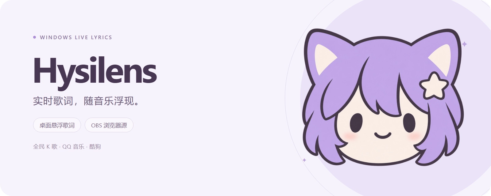
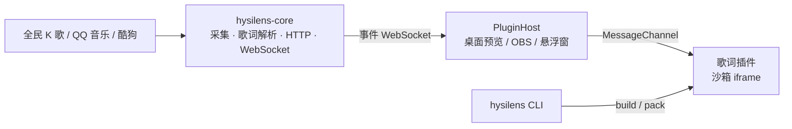

<p align="center">
  
</p>

<p align="center">
  Windows 实时歌词工具：从全民 K 歌、QQ 音乐和酷狗读取正在播放的歌词，<br />
  输出到 OBS 浏览器源，或作为透明置顶的桌面悬浮歌词。
</p>

<p align="center">
  <a href="docs/renderer-plugins.md">歌词插件开发</a>
  ·
  <a href="docs/plugin-system.md">插件系统设计</a>
</p>

<p align="center">
  
  
  
  
  
</p>

> [!NOTE]
>
> 播放器适配只读取进程内存和本地歌词缓存：不注入 DLL、不 Hook、不写入播放器进程。内存读取依赖播放器版本，播放器更新后可能需要重新适配。

## 它能做什么？

- **自动跟随播放器**：同时识别全民 K 歌、QQ 音乐和酷狗，自动来源优先跟随全民 K 歌，再回退到 QQ 音乐和酷狗；歌词匹配存在歧义时保留候选，可手动选择。
- **逐字歌词**：原文、注音／罗马音与翻译分轨处理，支持逐字或整句呈现与时间偏移校准。
- **OBS 浏览器源**：默认地址 `http://127.0.0.1:38473/`，透明背景，按插件推荐的画布尺寸设置即可。
- **本地悬浮歌词**：透明、无边框、始终置顶，可开启鼠标穿透；按住右键拖动，位置自动保存。
- **歌词插件**：画面由插件决定，每个插件都是运行在沙箱中的独立网页，可以用任何前端框架编写，配置界面根据插件声明自动生成。
- **单文件发布**：前端与内置插件嵌入 `hysilens.exe`，运行不依赖 Node.js 或额外的服务程序。

## 播放器支持

- [x] **全民 K 歌**：只读进程内存，获取歌词、注音与时间轴
- [x] **QQ 音乐**：Windows 媒体会话提供歌曲与播放状态，本地 QRC 缓存提供歌词
- [x] **酷狗**：Windows 媒体会话提供歌曲与状态，只读内存获取进度与时长，本地 KRC 缓存提供歌词

QQ 音乐和酷狗的默认缓存目录分别为 `D:/QQMusicCache/QQMusicLyricNew` 与 `D:/Kugou/Lyric`，可在系统设置中修改。

## 歌词插件

| 插件             | 名称     | 建议画布   |
| ---------------- | -------- | ---------- |
| `builtin:scroll` | 滚动歌词 | 960 × 540  |
| `builtin:tilted` | 透视描边 | 1280 × 720 |

`builtin:` 前缀保留给随应用发布的插件。其他效果作为外部插件独立开发，用 `hysilens` CLI 完成从脚手架到分发的全流程：

```bash
hysilens create my-lyrics   # 创建插件
hysilens dev                # 开发工具：画布、播放控制、测试歌词、配置面板
hysilens pack               # 构建并打包为 zip，在插件面板「安装插件」
hysilens link               # 或者链接到用户插件目录，在应用中实时调试
```

插件接口、配置声明与沙箱限制见 [歌词插件开发](docs/renderer-plugins.md)。



## 开发

需要 [Vite+](https://viteplus.dev/)、Rust（MSVC 工具链）、Visual Studio C++ Build Tools、Windows SDK 与 WebView2 Runtime。

```powershell
vp install
vp run dev                # Tauri + 进程内服务 + 前端开发环境

vp run build              # 构建单文件 target/release/hysilens.exe
```

任务定义在各自的包里，在包目录中直接 `vp run <任务>`，或在任意位置用 `vp run <包名>#<任务>`。

> [!TIP]
>
> 只运行服务时使用 `hysilens.exe --headless`，指定端口使用 `--port 38474`。开发代理固定连接 `127.0.0.1:38473`；修改服务端口后需同步调整 `apps/desktop/vite.config.ts` 的代理目标。

| 包                          | 任务           | 用途                                                  |
| --------------------------- | -------------- | ----------------------------------------------------- |
| `@hysilens/desktop-ui`      | `dev`          | 启动 Tauri、进程内服务和前端开发环境                  |
|                             | `build`        | 构建 Rust Release 可执行文件                          |
|                             | `dev:web`      | 仅启动控制界面，API 代理到本机 38473 端口；需已有服务 |
|                             | `build:web`    | 构建内置插件与桌面前端（Rust 编译前必需）             |
|                             | `plugins`      | 构建内置歌词插件并复制到 `public/plugins`             |
| `@hysilens/renderer-scroll` | `build`        | 构建滚动歌词插件                                      |
| `@hysilens/renderer-tilted` | `build`        | 构建透视描边插件                                      |
| `@hysilens/plugin`          | `build`        | 构建 ESM CLI、SDK 及内置开发工具                      |
| 根目录                      | `check:types`  | 工作区 TypeScript 类型检查                            |
|                             | `check:native` | 构建前端后执行 Rust 格式与 Clippy 检查                |
|                             | `test:native`  | 构建前端后执行 Rust 单元测试                          |

`vp check` 负责格式、Lint 与类型检查，`vp test run` 运行前端、插件 SDK 与开发工具的单元测试。首次测试或使用 `hysilens dev` 前，先运行 `vp run @hysilens/plugin#build` 生成内置开发工具；修改开发工具后也需重新构建。

检查与测试不会自动启动应用、播放器或 OBS；窗口透明、置顶、拖动、鼠标穿透与真实播放器同步需要手动验证。

### 项目结构

- [`apps/desktop`](apps/desktop)：React 控制界面与插件宿主；`src-tauri` 管理主窗口、本地悬浮窗与服务生命周期
- [`crates/hysilens-core`](crates/hysilens-core)：播放器采集、歌词解析、配置、HTTP 与 WebSocket
- [`packages/plugin`](packages/plugin)：插件 SDK、`PluginHost`、`hysilens` CLI 与 Vite 集成
- [`packages/devtools`](packages/devtools)：`hysilens dev` 的开发工具界面
- [`packages/protocol`](packages/protocol)：TypeScript 协议与宿主配置
- [`packages/ui`](packages/ui)：React UI 组件
- [`plugins`](plugins)：内置歌词插件 `scroll` 与 `tilted`

### 数据目录

用户数据保存在 `%LOCALAPPDATA%/Hysilens/`，可用 `HYSILENS_DATA_DIR`、`HYSILENS_PLUGINS_DIR`、`HYSILENS_PLUGIN_CONFIGS_DIR` 覆盖：

```text
settings.json                     播放来源、缓存目录、端口和宿主设置
local-overlay.json                本地悬浮窗位置与鼠标穿透
plugins/<id>/                     用户安装的歌词插件
plugin-configs/<id>.json          外部插件配置
plugin-configs/builtin/<名称>.json 内置插件配置
```

## 致谢

第三方实现来源与许可证声明见 [THIRD_PARTY_NOTICES.md](THIRD_PARTY_NOTICES.md)。
